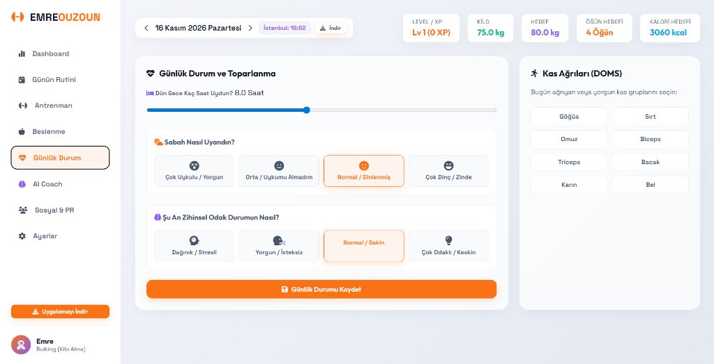
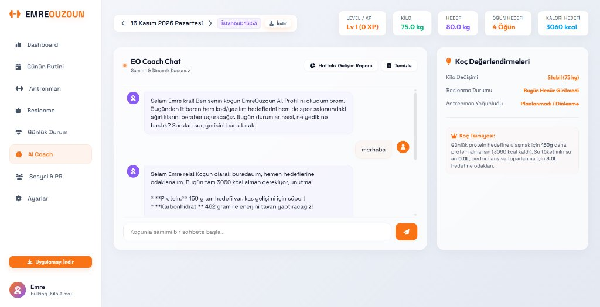

# EOCoaching — AI Fitness & Nutrition Coach

EOCoaching is a personal fitness, nutrition, and daily routine tracking application powered by Google Gemini. I built it to keep everything I need in one place: workout logging with RIR-based progressive overload, calorie and macro tracking (including photo-based food estimation), sleep/recovery check-ins, and an AI coach that actually knows my daily numbers.

It runs as a local Python + SQLite web app, as an installable PWA, or as a standalone offline file across Windows, Android, iOS, and macOS.

---

## Privacy & API Key Security (Your Key Stays on Your Device)

Because EOCoaching asks each user to enter their own Google Gemini API key during setup, it is completely natural to wonder whether the author of this repository can see, collect, or access your key. **I have zero access to your API key or your personal data.**

- **100% Local Execution (No Central Server):** EOCoaching does not connect to any developer-owned cloud server, analytics service, or external database. Every user runs the application directly on their own computer or phone.
- **Stored Only on Your Machine:** When running with the local Python server, your key is saved only inside your own machine's `data/aicoaching.db` SQLite file (obfuscated locally). When running the standalone `.exe` or portable `.html` version, it is stored solely inside your browser's `localStorage` on your device.
- **Direct Connection to Google:** All AI requests (chat, workout generation, meal parsing, and food vision) are sent directly from your browser to Google's official endpoint (`generativelanguage.googleapis.com`)—never routed through any proxy or third-party server.
- **Fully Open Source:** Every line of client and server code (`app.js`, `server.py`) is visible in this repository so you can verify yourself that no telemetry, tracking, or key forwarding exists.

---

## Interface & Walkthrough

### 1. Dashboard
The main dashboard gives a quick overview of the day: a calorie progress ring, water intake, workout completion, sleep duration, body weight trend chart, and macro breakdown (Protein, Carbs, Fat). At the top bar, you can switch dates, track your XP level, or open the download center.


### 2. Daily Routine Planner
The routine tab lets you organize your day chronologically. You can add tasks manually, load your default schedule, or describe your day in plain text (work hours, meetings, workout time) so the AI builds a structured timeline for you.


### 3. Workout & Progressive Overload Assistant
Here you can manage your daily exercises, sets, reps, weights, and RIR (Reps in Reserve). The Progressive Overload Assistant on the right checks your previous sessions and suggests today's target weights and reps. You can also launch the Live Workout Session mode with automatic rest timers, or ask the AI to critique your current split.


### 4. Nutrition & Hydration
You can log meals in three ways: typing naturally in the AI Food Parser (e.g., "100g oats, 3 eggs"), uploading a meal photo for Gemini Vision estimation, or using the quick-add/manual form. Frequent meals can be starred into Favorites, and you can copy yesterday's meals with one click.


### 5. Daily Recovery & DOMS
Before or after training, you can log how many hours you slept, how rested you woke up, your mental focus level, and which muscle groups are currently sore (DOMS).



### 6. AI Coach Chat & Insights
The AI Coach reads your current profile, targets, calorie intake, sleep, and workout status before replying. You can choose the coach's communication style (casual or formal), generate a 7-day progress report, and view real-time nutrition and training insights on the right panel.



---

## Downloads (Windows / Android / iOS / macOS)

Pre-built packages are available in the `downloads/` folder and directly via the links below:

- **Windows (.exe Desktop App):** [Download EOcoachingWindows.exe](https://github.com/EmreOuzouns/EOCoaching/raw/main/downloads/EOcoachingWindows.exe)
- **Windows (.zip Bundle):** [Download EOcoachingWindows.zip](https://github.com/EmreOuzouns/EOCoaching/raw/main/downloads/EOcoachingWindows.zip)
- **Android (.zip Package):** [Download EOcoachingAndroid.zip](https://github.com/EmreOuzouns/EOCoaching/raw/main/downloads/EOcoachingAndroid.zip)
- **iOS (.zip Package with WebClip Profile):** [Download EOcoachingiOS.zip](https://github.com/EmreOuzouns/EOCoaching/raw/main/downloads/EOcoachingiOS.zip)
- **macOS (.zip App Bundle):** [Download EOcoachingmacOS.zip](https://github.com/EmreOuzouns/EOCoaching/raw/main/downloads/EOcoachingmacOS.zip)
- **Universal Portable App (.html):** [Download EOcoachingPortable.html](https://github.com/EmreOuzouns/EOCoaching/raw/main/downloads/EOcoachingPortable.html)

---

## Project Structure

- `server.py` - Backend server supporting FastAPI/Uvicorn with an automatic stdlib `ThreadingHTTPServer` fallback, SQLite persistence, and multi-platform packaging.
- `app.js` - Frontend application logic, Gemini API integration, chart rendering, and a hybrid `localStorage` fallback engine for offline standalone use.
- `index.html` & `style.css` - Main single-page interface with a light glassmorphism design.
- `download.html` - Cross-platform download page served at `/indir`.
- `sw.js` & `manifest.json` - PWA Service Worker and manifest for mobile/desktop installation.
- `downloads/` - Compiled Windows executable and platform `.zip` archives.
- `screenshots/` - UI preview images.

---

## How to Run

### Option 1: Standalone (No Setup)
Download `EOcoachingWindows.exe` (or extract the `.zip` for your platform) and open it directly. All data is saved locally in your browser/app storage.

### Option 2: Local Python Server (SQLite)
1. Clone the repository:
   ```bash
   git clone https://github.com/EmreOuzouns/EOCoaching.git
   cd EOCoaching
   ```
2. Start the server (works with standard Python 3 out of the box, or optionally with `pip install -r requirements.txt`):
   ```bash
   python server.py
   ```
3. Open `http://localhost:8090` in your browser (or `http://localhost:8090/indir` for the download page).

---

## License

This project is licensed under the MIT License - see the [LICENSE](LICENSE) file for details.
