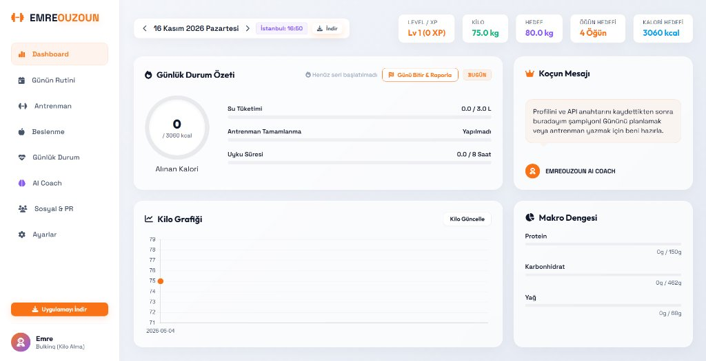
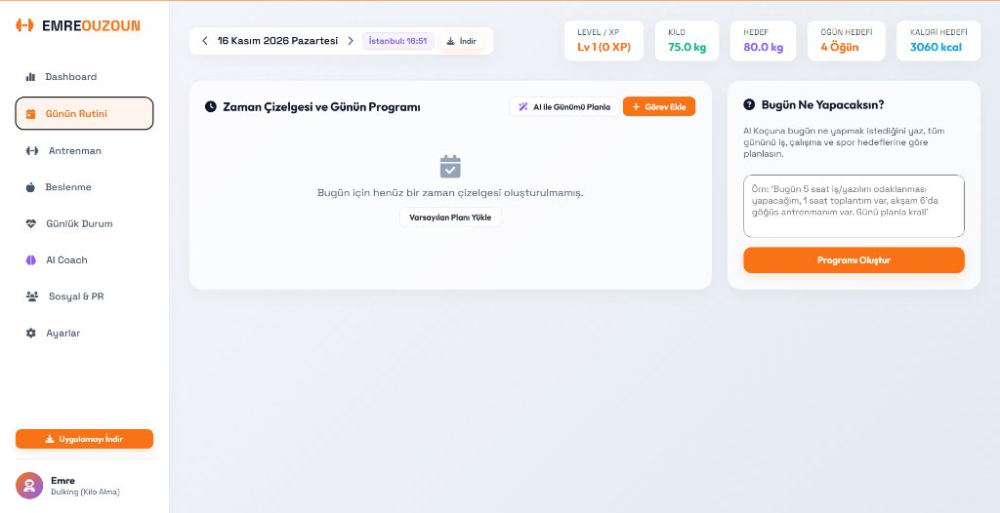
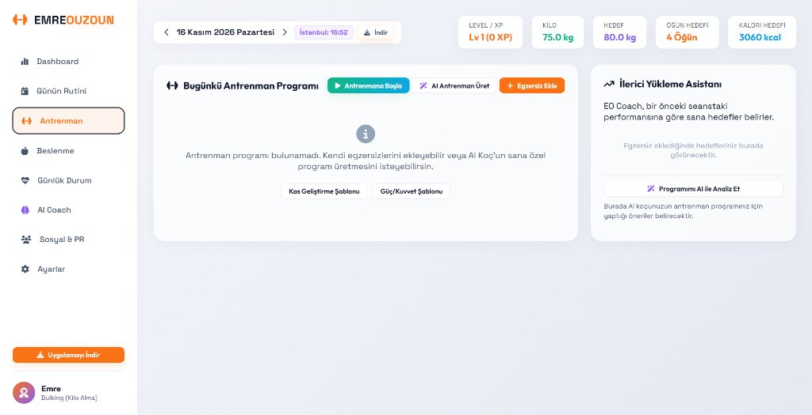
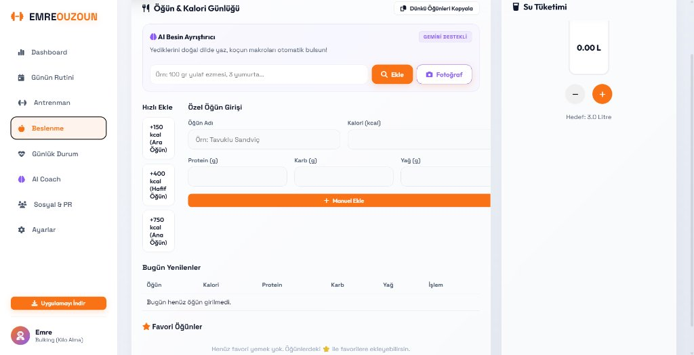

# EOCoaching — AI Fitness & Nutrition Coach

EOCoaching is a cross-platform personal fitness, nutrition, and daily routine coaching application built to bring training logs, progressive overload planning, macro tracking, and AI-assisted guidance together in one place. Instead of juggling separate apps for workout spreadsheets, calorie counters, habit trackers, and chat-based coaching, EOCoaching unifies them around a single daily log per user. The application integrates the Google Gemini API (`gemini-2.5-flash` and `gemini-2.5-flash-lite`) with a Bring-Your-Own-Key (BYOK) onboarding flow so that every user supplies and stores their own API key locally without relying on a shared server credential.

On the engineering side, EOCoaching is built with a vanilla HTML5, CSS3 (glassmorphism UI), and ES6+ JavaScript frontend paired with Chart.js for body-weight trend visualization and a Service Worker (`sw.js`) + Web App Manifest (`manifest.json`) for Progressive Web App support. The backend (`server.py`) uses Python 3 with FastAPI and Uvicorn while automatically falling back to a zero-dependency standard-library `ThreadingHTTPServer` when binary wheels are unavailable, storing user profiles, daily logs, chat history, favorite meals, and personal records inside a local SQLite database (`data/aicoaching.db`). To make the app portable across Windows, Android, iOS, and macOS, a hybrid storage interceptor in `app.js` mirrors data to `localStorage` so that compiled standalone packages (including a C#-compiled Windows `.exe` wrapper and self-contained HTML bundles) run completely offline even without a Python backend.

---

## Technical Overview

### Architecture & Key Components

- **Backend & Storage (`server.py`, SQLite3):**
  - Dual-mode HTTP server supporting both `FastAPI + Uvicorn` and a built-in `ThreadingHTTPServer` fallback.
  - 5-table SQLite schema (`users`, `daily_logs`, `chat_history`, `meal_favorites`, `pr_history`) with automatic legacy JSON migration and Base64-XOR API key obfuscation.
  - Dynamic multi-platform packager (`/api/download/{platform}`) generating standalone HTML bundles, Windows/macOS launchers, and iOS `.mobileconfig` WebClip profiles.
- **Frontend & Hybrid Offline Engine (`app.js`, `index.html`, `style.css`):**
  - **Hybrid `fetch` Interceptor:** Routes `/api/*` calls to the SQLite backend when available and transparently falls back to `localStorage` (`eocoach_offline_db_v2`) when opened standalone (`file://`) or offline.
  - **7-Step Onboarding Quiz:** Computes BMR and TDEE using the Mifflin-St Jeor equation, allocates daily protein/carb/fat targets, generates initial workout and routine templates, and includes a dedicated Step 7 for personal Gemini API key entry and live verification.
  - **Progressive Overload & Live Session:** Inspects past workout logs to recommend set-by-set weight, rep, and RIR (Reps in Reserve) targets, paired with automated rest timers (`90s` compound / `60s` isolation) and Squat/Bench/Deadlift PR tracking.
- **Cross-Platform Downloads (`downloads/`):**
  - Pre-built packages for **Windows** ([`EOCoaching_Windows.exe`](https://github.com/EmreOuzouns/EOCoaching/raw/main/downloads/EOCoaching_Windows.exe), [`EOCoaching_Windows.zip`](https://github.com/EmreOuzouns/EOCoaching/raw/main/downloads/EOCoaching_Windows.zip)), **Android** ([`EOCoaching_Android.zip`](https://github.com/EmreOuzouns/EOCoaching/raw/main/downloads/EOCoaching_Android.zip)), **iOS** ([`EOCoaching_iOS.zip`](https://github.com/EmreOuzouns/EOCoaching/raw/main/downloads/EOCoaching_iOS.zip)), and **macOS** ([`EOCoaching_macOS.zip`](https://github.com/EmreOuzouns/EOCoaching/raw/main/downloads/EOCoaching_macOS.zip)).

### How to Run

1. **Standalone (No Setup):** Download `EOCoaching_Windows.exe` or extract the `.zip` package for your platform from `downloads/` and open it directly.
2. **Local Python Server:**
   ```bash
   git clone https://github.com/EmreOuzouns/EOCoaching.git
   cd EOCoaching
   python server.py
   ```
   Open `http://localhost:8090` for the main app or `http://localhost:8090/indir` for the download center.

---

## Interface & Screenshots

### Dashboard
The main dashboard summarizes daily calorie progress, hydration, workout completion, sleep duration, body-weight trends via Chart.js, and macronutrient distribution, alongside quick date navigation and XP level tracking.



### Daily Routine Planner
The routine view organizes the user's day chronologically. Tasks can be added manually, loaded from a personal template, or generated via Gemini from a plain-text description of work hours, meetings, and training times.



### Workout & Progressive Overload Assistant
The workout tab manages exercises, sets, reps, weights, and RIR values. On the right, the Progressive Overload Assistant calculates targets from previous sessions and provides AI-powered split critiques.



### Nutrition & Hydration
Meals can be logged via natural-language text parsing, Gemini Vision photo analysis, quick-add presets, or manual entry. Frequent meals can be starred into Favorites, and previous days' meals can be cloned in one click.



### Daily Recovery & DOMS
Users can record sleep hours, wake-up freshness, mental focus, and sore muscle groups (DOMS) so the coach can factor recovery into daily recommendations.


### AI Coach Chat & Insights
The chat console injects the user's live profile, calorie/macro adherence, sleep, and workout state into Gemini prompts while displaying real-time weight, nutrition, and training insights on the side panel.


---

## License

This project is licensed under the MIT License - see the [LICENSE](LICENSE) file for details.
